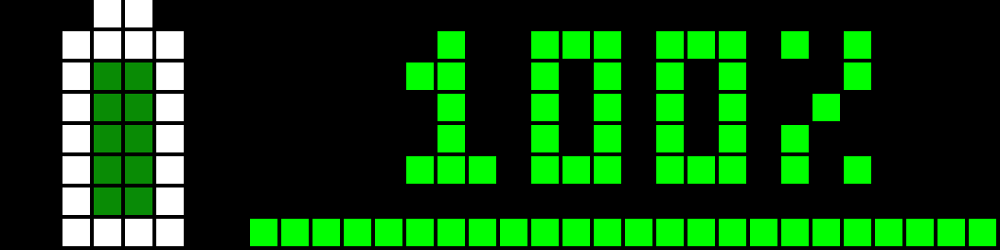
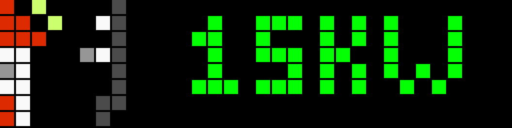

# Blueprints for AWTRIX 3 / SVITRIX

Variant for displays running **AWTRIX 3** or **SVITRIX**. For **AWTRIX NG** use the blueprints in [`../AwtrixNG`](../AwtrixNG/).

> The files were moved from the repository root to `Awtrix3/`. If you imported them earlier from the old path, import them again with the buttons below.

## Requirements

- Home Assistant with blueprint support and the MQTT integration
- Ulanzi TC001 (or compatible) with AWTRIX 3 / SVITRIX, connected to the same MQTT broker as Home Assistant
- The icons used by the blueprints, installed on the display. They are LaMetric icon IDs and are listed in each blueprint's description.

## Installation

1. Install the icons on the display with the icon downloader of the AWTRIX 3 web UI (LaMetric ID).
2. Import the blueprint with the button below, then create an automation from it.
3. Select your display(s) and sensors, and adjust thresholds and the display position.

## Blueprints

### Solar Power Monitor

Shows the current solar production in W or kW with color-coded icons.

| Color | Meaning |
|---|---|
| 🟢 green | high production (above high threshold) |
| 🟡 yellow | medium production |
| 🟠 orange | low production (above 0 W) |
| ⚪ gray | no production (0 W or night) |

Options: hide at 0 W, night-time filter, display position.

### Solar Battery Status

Shows the battery charge in % with color-coded icon and progress bar.

| Color | Meaning |
|---|---|
| 🟢 green | high charge (above high threshold) |
| 🟡 yellow | medium charge |
| 🔴 red | low charge (below low threshold) |

Optional power sensor: the progress bar turns green when charging, orange when discharging and white when idle. Without it the bar uses the state color.

### Grid Power Flow Monitor

Shows the grid power flow with a neutral zone around 0 W.

| Color | Meaning |
|---|---|
| 🟢 green | export (feed-in) |
| ⚪ white | neutral (within tolerance) |
| 🟠 orange | import (draw from grid) |

