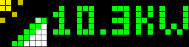
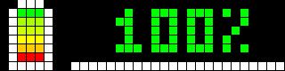
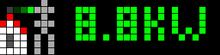

# Blueprints for AWTRIX NG

Variant for displays running **[AWTRIX NG](https://github.com/Blueforcer/awtrix-ng)**. For AWTRIX 3 / SVITRIX use the blueprints in [`../Awtrix3`](../Awtrix3/).

## Requirements

- Home Assistant with blueprint support and the MQTT integration
- Ulanzi TC001 (or compatible) with AWTRIX NG, MQTT and Home Assistant discovery enabled in the AWTRIX NG settings
- The display shows up in Home Assistant with its `mqtt_prefix` sensor (the blueprints use it to find the MQTT topic)
- The icons from the AWTRIX Hub (see below)

## Installation

1. **Install the icons** from the [AWTRIX Hub](https://awtrix.de/icons): open the icon, sign in and click **Send to AWTRIX**. Alternatively use **Icons -> Add -> Open icon gallery** in the display's web UI.

   | Blueprint | Hub search | Icon names (fixed) |
   |---|---|---|
   | Solar Power Monitor | `solar-roof` | `solar-roof-high`, `solar-roof-mid`, `solar-roof-low`, `solar-roof-night` |
   | Solar Battery Status | `bat` | `bat00`, `bat20`, `bat40`, `bat60`, `bat80`, `bat100` |
   | Grid Power Flow Monitor | `grid` | `grid-export`, `grid-neutral`, `grid-import` |

   The icon name is the file name without extension and is case-sensitive. AWTRIX itself never downloads icons from the internet.
2. **Import the blueprint** with the button below and create an automation from it.
3. **Select your display(s) and sensors.**
4. **Set the app order once** on the display (web UI). The apps are named `solar_power`, `solar_battery` and `grid_power`.

## Blueprints

### Solar Power Monitor

Shows the current solar production in W (kW above 1000 W) with an animated icon.

| Production | Icon | Color |
|---|---|---|
| above high threshold (default 400 W) | `solar-roof-high` | green |
| above low threshold (default 100 W) | `solar-roof-mid` | yellow |
| above 0 W | `solar-roof-low` | orange |
| 0 W | `solar-roof-night` | gray |

Options: remove the app at 0 W, or during a night window (may cross midnight, start = end disables it). Updated on every sensor change and every 5 minutes; the app disappears after 6 minutes without an update.

### Solar Battery Status

Shows the battery charge in % with an icon in 20 % steps (rounded to the nearest step), step-colored text from red to green and a progress bar with the exact level.

Optional power sensor: the progress bar is green when charging, orange when discharging and white when idle (tolerance default 5 W). Without it the bar uses the text color. Updated on every sensor change and every 5 minutes; the app disappears after 6 minutes without an update.

### Grid Power Flow Monitor

Shows the grid power flow in W (kW above 1000 W). The icon animation shows the direction of the flow.

| Grid power | Icon | Color |
|---|---|---|
| export (below -tolerance) | `grid-export` | green |
| neutral (within +/- tolerance, default 20 W) | `grid-neutral` | white |
| import (above +tolerance) | `grid-import` | orange |

The sensor must be positive for import and negative for export. If yours is the other way round, use a template sensor with the sign flipped. Updated on every sensor change and every 30 seconds; the app disappears after 2 minutes without an update.

## Migrating from AWTRIX 3 / SVITRIX

- The blueprints are separate files. Import the NG blueprints and create new automations; the old ones publish to `custom/...`, which AWTRIX NG does not use.
- Icons are named instead of numbered (see table above).
- The display position is no longer part of the payload. Set the app order once on the display.

## Troubleshooting

- **Nothing on the display:** check in an MQTT client that messages arrive on `<prefix>/cmd/apps/pushed/<app>`. The answer on `<prefix>/cmd/apps/pushed/<app>/result` shows `ok` or the validation error.
- **Topic starts with `unavailable`:** the `mqtt_prefix` sensor of the display is not available. Check that the display is online and discovery is enabled.
- **Text but no icon:** the icon is not installed on the display, or its name differs (case-sensitive).