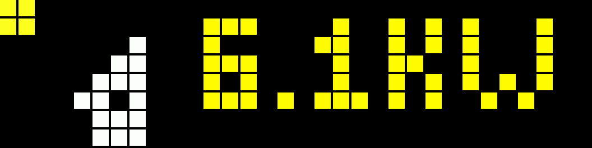
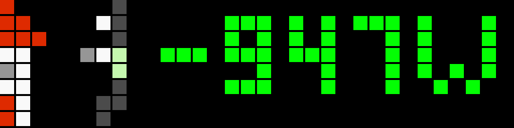

# HA Blueprints

Collection of Home Assistant automation blueprints for Ulanzi TC001 and compatible AWTRIX / SVITRIX LED displays.

## Included Blueprints

### Solar Power Monitor (`solarpower.yaml`)
Displays current solar power production on your display in watts or kilowatts with color-coded icons.
- 🟢 Green: High production (above high threshold)
- 🟡 Yellow: Medium production (between high and low threshold)
- 🟠 Orange: Low production (below low threshold but above 0W)
- ⚪ Gray: No production (0W or night time)

Features: Optional night-time filtering, hide-at-zero behavior, display position control.

### Solar Battery Status (`solarbattery.yaml`)
Displays your PV battery charge level in percent with color-coded icons and progress bar.
- 🟢 Green: High charge (above high threshold)
- 🟡 Yellow: Medium charge (between high and low threshold)
- 🔴 Red: Low charge (below low threshold)

Optional: Power sensor for progress bar charging/discharging indication (green for charging, orange for discharging, white for idle). Without power sensor, progress bar uses battery state color.

### Grid Power Flow Monitor (`gridpower.yaml`)
Displays current grid import/export power with a tolerance-based neutral zone.
- 🟢 Green: Export / Feed-in to grid
- ⚪ White: Neutral range around 0 W
- 🟠 Orange: Import / Draw from grid

Display toggles based on power flow within tolerance threshold.

## Import Links

- `solarpower.yaml`:
  
- `solarbattery.yaml`:
  
- `gridpower.yaml`:
  

Use these buttons to open the Home Assistant blueprint import page directly.

## Requirements

- Home Assistant with automation-blueprint support
- Ulanzi TC001 or compatible device with AWTRIX / SVITRIX firmware
- MQTT integration and home assistant device discovery
- Required icons installed on the device

### Required Icons by Blueprint

**Solar Power Monitor:**
- 54156 (solar-green)
- 50557 (solar-white-dyn)
- 50556 (solar-static)
- 54876 (Solar Power Night Light)

**Solar Battery Status:**
- 6358 (battery full)
- 6356 (battery medium)
- 6354 (battery empty)

**Grid Power Flow Monitor:**
- 71129 (pv grid export)
- 71130 (grid import)
- 71132 (no export no import grid)

## Setup & Usage

1. Use import buttons above or copy blueprint files to `blueprints/automation/` folder.
2. Reload blueprints in Home Assistant.
3. Create automation from blueprint.
4. Select AWTRIX / SVITRIX device and appropriate sensor(s).
5. Adjust thresholds and optional display position as needed.

---

# Deutsche Zusammenfassung

Sammlung von Home Assistant Blueprints für Ulanzi TC001 und kompatible AWTRIX / SVITRIX LED-Displays.

## Enthaltene Blueprints

### Solar Power Monitor (`solarpower.yaml`)
Zeigt die aktuelle Solarproduktion in Watt oder Kilowatt mit farbcodierten Icons an.
- 🟢 Grün: Hohe Produktion (über Schwellenwert High)
- 🟡 Gelb: Mittlere Produktion (zwischen High und Low)
- 🟠 Orange: Niedrige Produktion (unter Low, aber über 0W)
- ⚪ Grau: Keine Produktion (0W oder Nacht)

Optionale Funktionen: Nachtzeitfilterung, Ausblendung bei 0W, Anzeigeposition im Display-Loop.

### Solar Battery Status (`solarbattery.yaml`)
Zeigt den Ladezustand der PV-Batterie in Prozent mit farbcodierten Icons und Fortschrittsbalken an.
- 🟢 Grün: Hoher Ladezustand (über Schwellenwert High)
- 🟡 Gelb: Mittlerer Ladezustand (zwischen High und Low)
- 🔴 Rot: Niedriger Ladezustand (unter Schwellenwert Low)

Optional: Stromsensor zur Fortschrittsbalken-Anzeige des Lade-/Entladezustands (grün zum Laden, orange zum Entladen, weiß für Idle). Ohne Stromsensor verwendet der Fortschrittsbalken die Batteriezustandsfarbe.

### Grid Power Flow Monitor (`gridpower.yaml`)
Zeigt den aktuellen Netzstrom (Import/Export) mit toleranzbasierter Neutralzone an.
- 🟢 Grün: Einspeisung ins Netz (Export)
- ⚪ Weiß: Neutralzone um 0W
- 🟠 Orange: Bezug aus dem Netz (Import)

Die Anzeige wechselt basierend auf dem Stromfluss innerhalb des Toleranzbereichs.

## Anforderungen

- Home Assistant mit Blueprint-Unterstützung
- Ulanzi TC001 oder kompatibles Gerät mit AWTRIX / SVITRIX Firmware
- MQTT-Integration und Home Assistant Device Discovery
- Benötigte Icons auf dem Gerät installiert

## Einrichtung & Verwendung

1. Import-Buttons oben verwenden oder Blueprint-Dateien manuell in den `blueprints/automation/` Ordner kopieren.
2. Blueprints in Home Assistant neu laden.
3. Automation aus dem Blueprint erstellen.
4. AWTRIX / SVITRIX Gerät und entsprechende Sensor(en) auswählen.
5. Schwellenwerte und optionale Anzeigeposition anpassen.

